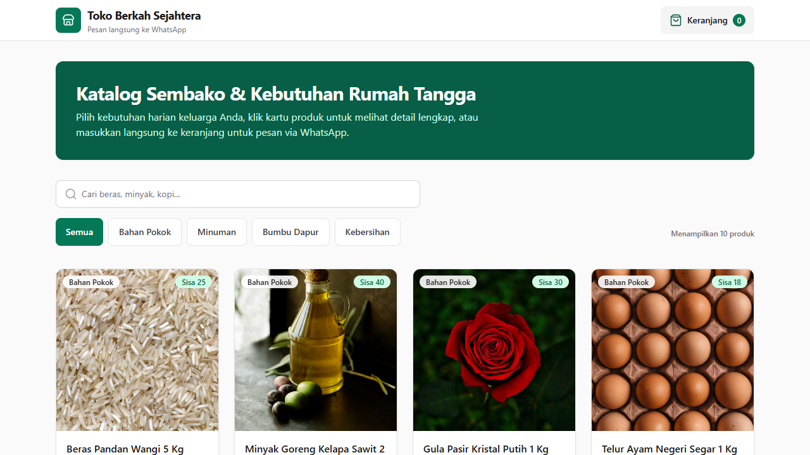
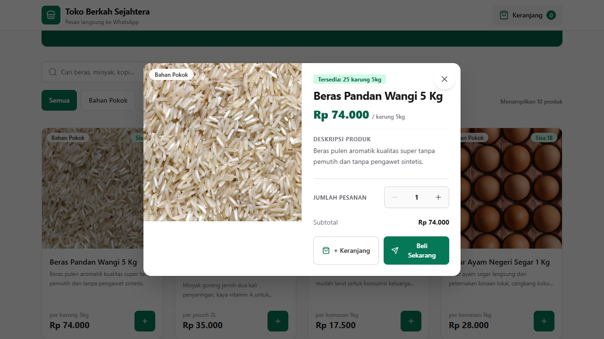
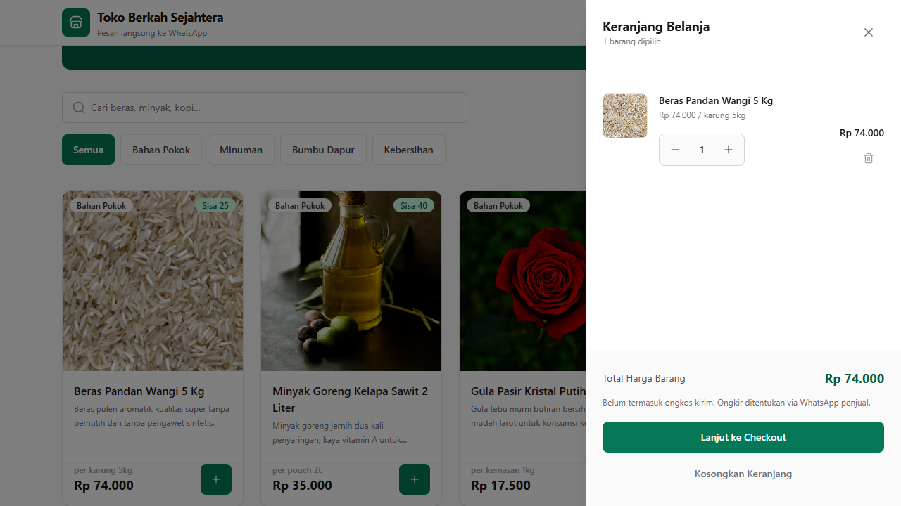
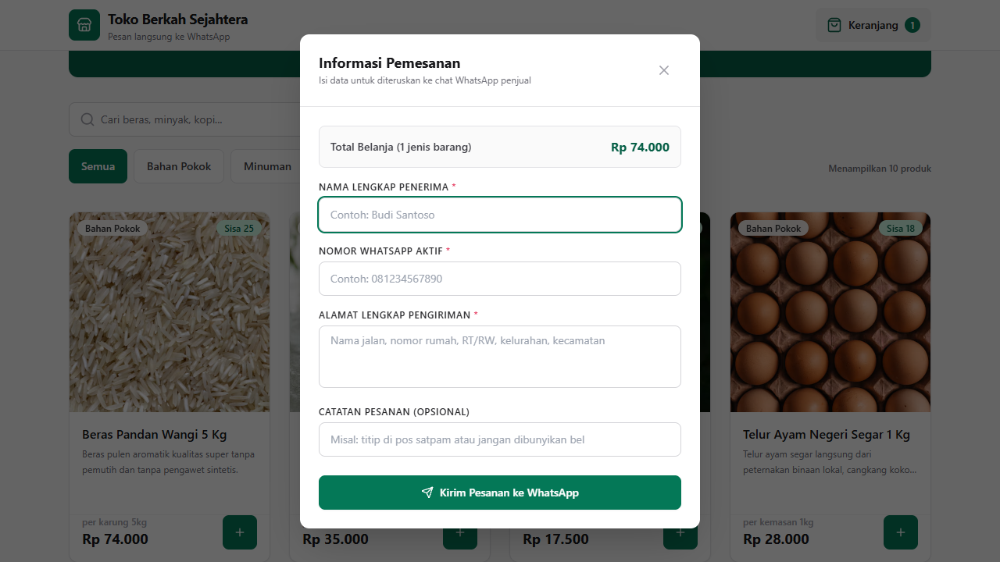
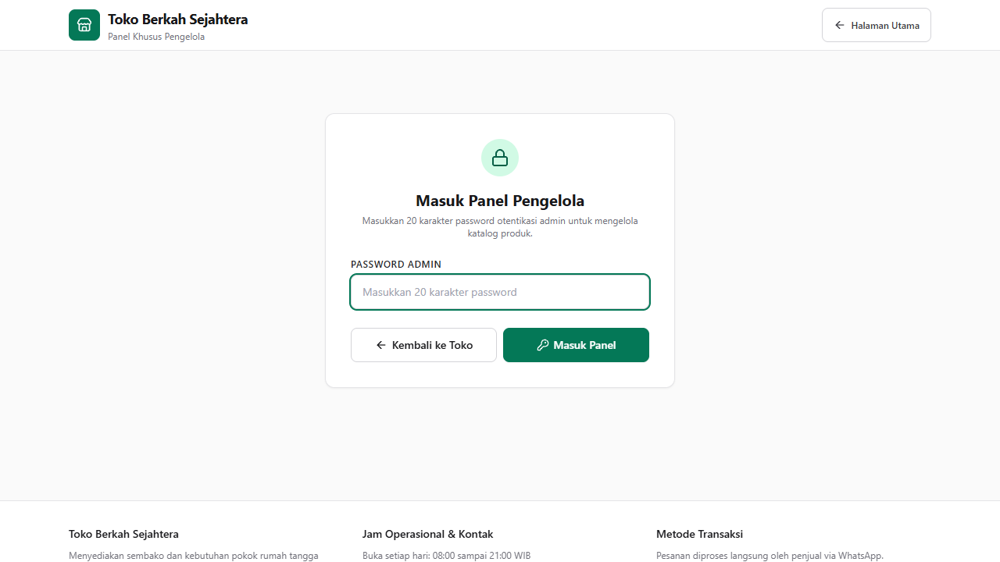
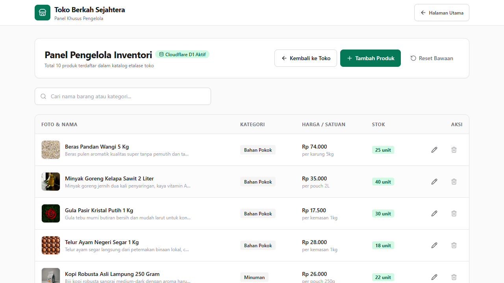

# Toko Sembako Mini (Direct WhatsApp Checkout & Cloudflare D1 Admin)

[](https://toko-mini.pages.dev)
[](https://developers.cloudflare.com/d1/)
[](https://react.dev)
[](https://www.typescriptlang.org/)
[](https://tailwindcss.com/)
[](LICENSE)

Aplikasi toko sembako dan kebutuhan harian online berbasis web modern, cepat, dan ringan. Dilengkapi dengan katalog produk interaktif, modal detail barang, sistem keranjang belanja lokal, konfirmasi pesanan instan via WhatsApp penjual, serta panel pengelola produk (CRUD) tersembunyi yang didukung oleh database serverless Cloudflare D1.

---

## Tampilan Antarmuka (Screenshots)

### 1. Katalog Produk & Filter Kategori
Tampilan beranda yang bersih dengan fitur pencarian real-time dan penyaringan berbasis kategori kebutuhan rumah tangga.


### 2. Modal Detail Produk & Pemilihan Jumlah
Pop-up informatif saat kartu produk diklik, menampilkan rincian mutu, satuan, stok tersisa, pemilihan jumlah, tombol tambah keranjang, dan beli sekarang.


### 3. Drawer Keranjang Belanja
Panel samping interaktif untuk meninjau pesanan, mengatur kuantitas barang, menghapus item, serta melihat kalkulasi subtotal.


### 4. Formulir Checkout & Direct WhatsApp
Pengisian nama penerima, nomor kontak, serta alamat lengkap yang otomatis dikonversi menjadi format pesan chat WhatsApp rapi ke penjual.


### 5. Akses Panel Admin Tersembunyi (`/admin`)
Halaman login terisolasi yang tidak tampak di navigasi publik, dilindungi oleh password otentikasi admin 20 karakter.


### 6. Dashboard Manajemen Inventori (CRUD Produk)
Panel pengelola untuk menambah produk baru, mengedit harga/stok, menghapus produk, serta memantau status database Cloudflare D1 secara langsung.


---

## Fitur Utama

### 🛒 Sisi Pembeli (Storefront)
- **Katalog Produk Dinamis**: Data produk tersinkronisasi online dari database edge Cloudflare D1 dengan fallback otomatis ke penyimpanan lokal browser.
- **Pencarian & Filter Cepat**: Filter multi-kategori (Bahan Pokok, Minuman, Bumbu Dapur, Kebersihan) dengan input pencarian instan.
- **Modal Detail Produk**: Pratinjau gambar resolusi tinggi, deskripsi lengkap, stok tersisa, dan tombol *Beli Sekarang*.
- **Keranjang Belanja Persistent**: Menggunakan hook kustom `useCart` yang tersimpan otomatis di `localStorage`.
- **Checkout WhatsApp Langsung**: Mengirimkan data pemesan beserta rincian belanja ke link resmi WhatsApp `https://wa.me/...` tanpa perlu payment gateway rumit.

### 🔐 Sisi Pengelola (Admin Dashboard)
- **Rute Terisolasi (`/admin`)**: Tidak ada tombol admin di homepage pembeli untuk menjaga privasi pengelolaan toko.
- **Proteksi Password Kuat**: Dilindungi oleh password 20 karakter kombinasi huruf besar, huruf kecil, angka, dan simbol.
- **Operasi CRUD Lengkap**:
  - **Tambah Produk**: Formulir lengkap dengan validasi URL foto, nama, satuan, harga, dan deskripsi.
  - **Ubah Produk**: Pembaruan stok barang atau harga secara real-time.
  - **Hapus Produk**: Dilengkapi dengan dialog konfirmasi aman untuk mencegah salah klik.
  - **Reset Bawaan**: Kemudahan mengembalikan katalog ke 10 produk sembako bawaan.

### ♿ Desain & Aksesibilitas (Standar Antislop)
- Ukuran target sentuh tombol minimal 44x44px untuk kenyamanan perangkat layar sentuh.
- Kontras rasio teks memenuhi kepatuhan standar WCAG AA.
- Navigasi keyboard penuh (`Tab`, `Enter`, dan tombol `Escape` untuk menutup drawer/modal).
- Bebas karakter em dash dan copy alami bahasa Indonesia tanpa istilah artifisial.

---

## Arsitektur & Tech Stack

```text
toko-mini/
├── docs/screenshots/          # Pratinjau antarmuka untuk README
├── functions/api/             # Cloudflare Pages Functions (Serverless Edge API)
│   ├── products.ts            # GET all products & POST new product (PIN protected)
│   └── products/[id].ts       # PUT update product & DELETE product
├── migrations/
│   └── 0001_init.sql          # Skema database SQLite D1 dan seed data awal
├── public/
│   ├── _redirects             # Konfigurasi SPA routing untuk Cloudflare Pages
│   └── icons.svg              # Sprite SVG icons
├── src/
│   ├── components/            # Komponen antarmuka (Navbar, Filter, Card, Drawer, Modal)
│   │   ├── admin/             # Panel dashboard inventori dan autentikasi admin
│   │   └── ui/                # UI primitives (Button)
│   ├── data/products.ts       # Mock awal dan konstanta kontak toko
│   ├── hooks/                 # Custom React hooks (useCart, useProducts)
│   ├── lib/                   # Utilitas formatting mata uang dan WhatsApp parser
│   ├── App.tsx                # Komponen root aplikasi & router sederhana
│   └── main.tsx               # Titik masuk aplikasi
├── wrangler.toml              # Konfigurasi binding Cloudflare D1
└── package.json               # Dependensi dan build scripts
```

| Layer | Teknologi |
|---|---|
| **Frontend Framework** | React 19, TypeScript, Vite |
| **Styling System** | Tailwind CSS, Lucide React Icons |
| **Routing** | Native History API + Single Page Routing (`_redirects`) |
| **Database & API** | Cloudflare D1 (Serverless SQLite), Cloudflare Pages Functions |
| **Deployment** | Cloudflare Pages (Free Tier) |

---

## Panduan Menjalankan di Lokal (Local Development)

### 1. Prasyarat
- Node.js versi 20 atau lebih baru.
- npm atau pnpm.

### 2. Instalasi
```bash
# Clone repository
git clone https://github.com/AZWALUWU/toko-mini.git

# Masuk ke direktori
cd toko-mini

# Pasang dependensi
npm install
```

### 3. Menjalankan Server Pengembangan
```bash
npm run dev
```
Buka browser di `http://localhost:5173`. Aplikasi otomatis berjalan dengan penyimpanan lokal browser (`localStorage`) tanpa memerlukan koneksi server Cloudflare aktif.

### 4. Build Produksi & Self-Check
```bash
# Jalankan pengujian logika mandiri
node test-cart.mjs

# Build aset produksi
npm run build
```

---

## Kredensial Akses Admin

| Keterangan | Nilai |
|---|---|
| **URL Panel Admin** | `https://toko-mini.pages.dev/admin` (atau `/admin` di lokal) |
| **Password Admin** | `rfEoDAz$hY@N7v&2llE2` |
| **Karakteristik** | 20 karakter (kombinasi huruf besar, kecil, angka, dan simbol) |

---

## Konfigurasi Cloudflare Pages & D1 Database

Jika Anda ingin men-deploy instance mandiri ke akun Cloudflare pribadi:

1. **Buat Database D1**:
   ```bash
   npx wrangler d1 create toko-mini-db
   ```
2. **Jalankan Migrasi Database**:
   ```bash
   npx wrangler d1 execute toko-mini-db --remote --file=./migrations/0001_init.sql
   ```
3. **Deploy ke Cloudflare Pages**:
   ```bash
   npx wrangler pages project create toko-mini --production-branch=main
   npx wrangler pages deploy dist --project-name=toko-mini --branch=main
   ```
4. **Hubungkan Binding D1**:
   Di Cloudflare Dashboard: **Workers & Pages** > `toko-mini` > **Settings** > **Functions** > **D1 Database Bindings**:
   - Variable name: `DB`
   - D1 database: `toko-mini-db`

---

## Lisensi

Proyek ini dirilis di bawah lisensi [MIT](LICENSE). Silakan gunakan dan kembangkan untuk kebutuhan tugas, portofolio, atau operasional toko UMKM Anda.
